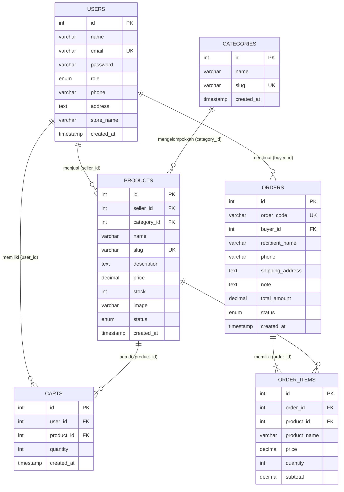

# Dokumentasi Aplikasi Web Toko Bunga — **Florist Mellysa**

**Mata Uji:** SOAL 11 — Perancangan dan Pembangunan Aplikasi Web Marketplace Tradisional
**Stack:** PHP Native (mysqli) · MySQL/MariaDB · Bootstrap 5
**Target deployment:** InfinityFree (`https://infinityfree.com`)

---

## 1. Ringkasan Aplikasi

**Florist Mellysa** adalah toko bunga online yang memungkinkan:

- **Penjual** mendaftarkan toko, menambah/mengubah/menghapus produk, dan mengelola pesanan masuk.
- **Pembeli** melihat daftar produk, melihat detail produk, menambahkan produk ke keranjang, dan membuat pesanan yang tersimpan ke database.

Aplikasi dibangun dengan **PHP Native**, akses database memakai **MySQLi** (prepared statement), dan tampilan memakai **Bootstrap 5** (CDN).

---

# A. ANALISIS DAN PERANCANGAN SISTEM

## a. Identifikasi Entitas

Dibutuhkan **6 entitas** (melebihi minimal 5):

| No | Entitas | Deskripsi |
|----|---------|-----------|
| 1 | **users** | Semua pengguna aplikasi, dibedakan lewat kolom `role` (`penjual` / `pembeli`). |
| 2 | **categories** | Kategori produk (mis. **Bunga & Tanaman**) untuk mengelompokkan produk. |
| 3 | **products** | Produk yang dijual oleh penjual. |
| 4 | **carts** | Item keranjang belanja milik pembeli (relasi pembeli ↔ produk). |
| 5 | **orders** | Header transaksi pemesanan yang dibuat pembeli. |
| 6 | **order_items** | Rincian produk pada setiap pesanan (detail transaksi). |

## b. Rancangan Database Relasional

### 1) Tabel `users`

| Atribut | Tipe | Keterangan |
|---------|------|-----------|
| **id** (PK) | INT AUTO_INCREMENT | Primary key |
| name | VARCHAR(100) | Nama pengguna |
| email | VARCHAR(150), UNIQUE | Login pengguna |
| password | VARCHAR(255) | Hash password (`password_hash`) |
| role | ENUM('penjual','pembeli') | Peran pengguna |
| phone | VARCHAR(20) | Nomor telepon |
| address | TEXT | Alamat |
| store_name | VARCHAR(150) | Nama toko (khusus penjual) |
| created_at | TIMESTAMP | Waktu daftar |

### 2) Tabel `categories`

| Atribut | Tipe | Keterangan |
|---------|------|-----------|
| **id** (PK) | INT AUTO_INCREMENT | Primary key |
| name | VARCHAR(100) | Nama kategori |
| slug | VARCHAR(120), UNIQUE | Slug untuk URL |
| created_at | TIMESTAMP | Waktu dibuat |

### 3) Tabel `products`

| Atribut | Tipe | Keterangan |
|---------|------|-----------|
| **id** (PK) | INT AUTO_INCREMENT | Primary key |
| **seller_id** (FK) | INT → `users.id` | Penjual produk |
| **category_id** (FK) | INT → `categories.id` | Kategori produk |
| name | VARCHAR(150) | Nama produk |
| slug | VARCHAR(180), UNIQUE | Slug untuk URL detail |
| description | TEXT | Deskripsi |
| price | DECIMAL(12,2) | Harga |
| stock | INT | Stok |
| image | VARCHAR(255) | Nama file/URL gambar |
| status | ENUM('aktif','nonaktif') | Status tayang |
| created_at | TIMESTAMP | Waktu dibuat |

### 4) Tabel `carts`

| Atribut | Tipe | Keterangan |
|---------|------|-----------|
| **id** (PK) | INT AUTO_INCREMENT | Primary key |
| **user_id** (FK) | INT → `users.id` | Pemilik keranjang (pembeli) |
| **product_id** (FK) | INT → `products.id` | Produk |
| quantity | INT | Jumlah |
| created_at | TIMESTAMP | Waktu ditambahkan |
| — | UNIQUE(user_id, product_id) | 1 produk hanya 1 baris per pembeli |

### 5) Tabel `orders`

| Atribut | Tipe | Keterangan |
|---------|------|-----------|
| **id** (PK) | INT AUTO_INCREMENT | Primary key |
| order_code | VARCHAR(30), UNIQUE | Kode pesanan (mis. `INV-20261116-1CBD80`) |
| **buyer_id** (FK) | INT → `users.id` | Pembeli yang memesan |
| recipient_name | VARCHAR(100) | Nama penerima |
| phone | VARCHAR(20) | Telepon penerima |
| shipping_address | TEXT | Alamat kirim |
| note | TEXT | Catatan (opsional) |
| total_amount | DECIMAL(12,2) | Total nilai pesanan |
| status | ENUM('pending','diproses','dikirim','selesai','dibatalkan') | Status pesanan |
| created_at | TIMESTAMP | Waktu pesanan dibuat |

### 6) Tabel `order_items`

| Atribut | Tipe | Keterangan |
|---------|------|-----------|
| **id** (PK) | INT AUTO_INCREMENT | Primary key |
| **order_id** (FK) | INT → `orders.id` | Induk pesanan |
| **product_id** (FK) | INT → `products.id` | Produk yang dibeli |
| product_name | VARCHAR(150) | *Snapshot* nama produk saat membeli |
| price | DECIMAL(12,2) | *Snapshot* harga saat membeli |
| quantity | INT | Jumlah beli |
| subtotal | DECIMAL(12,2) | price × quantity |

> **Catatan:** `product_name` dan `price` disimpan ulang di `order_items` sebagai *snapshot*, agar riwayat transaksi tetap utuh walaupun produk diubah/dihapus kemudian.

### Relasi Antar Tabel

| Relasi | Kardinalitas | Keterangan |
|--------|--------------|-----------|
| `users` → `products` | 1 : N | Satu penjual menjual banyak produk |
| `categories` → `products` | 1 : N | Satu kategori memuat banyak produk |
| `users` → `carts` | 1 : N | Satu pembeli punya banyak item keranjang |
| `products` → `carts` | 1 : N | Satu produk dapat ada di banyak keranjang |
| `users` → `orders` | 1 : N | Satu pembeli membuat banyak pesanan |
| `orders` → `order_items` | 1 : N | Satu pesanan punya banyak detail item |
| `products` → `order_items` | 1 : N | Satu produk tercatat di banyak detail pesanan |

Aturan integritas: `ON DELETE CASCADE` untuk data turunan (detail, keranjang, produk milik penjual) dan `ON DELETE SET NULL` untuk `products.category_id` (produk tetap ada bila kategori dihapus).

## c. ERD (Entity Relationship Diagram)



Versi gambar: lihat [erd.svg](erd.svg). Versi teks ringkas:

```
    users 1 ────< products >──── 1 categories
      │ 1            │ 1
      │              │
      │ N            │ N
    carts <──────────┘
      ^
      │ N
      │
    1 │           1 orders 1 ────< N order_items >──── 1 products
    users ──────────┘
```

## d. Alur Proses Transaksi

Alur dari pembeli memilih produk sampai pesanan tersimpan:

```
[ Pembeli buka Beranda / Daftar Produk ]
              │
              ▼
[ Pilih produk → Halaman Detail Produk ]  (product.php)
              │
              ▼
[ Klik "Tambah ke Keranjang" ]  → validasi: login? stok cukup?
              │                        (cart-action.php: action=add)
              ▼
[ Halaman Keranjang ]  (cart.php)
   • ubah jumlah / hapus item / kosongkan
              │
              ▼
[ Klik "Lanjut ke Checkout" ]  → isi nama penerima, telepon, alamat
              │                        (checkout.php)
              ▼
[ Klik "Buat Pesanan" ]  → PROSES DATABASE (dalam 1 transaksi/atomik):
   1. INSERT INTO orders          → dapat order_id
   2. INSERT INTO order_items     → untuk setiap item keranjang
   3. UPDATE products SET stock = stock - qty   → kurangi stok
   4. DELETE FROM carts WHERE user_id = ?       → kosongkan keranjang
   └─ commit  (bila ada error → rollback)
              │
              ▼
[ Halaman Sukses ] menampilkan kode pesanan (order-success.php)
              │
              ▼
[ Penjual melihat pesanan & mengubah status ]  (admin/orders.php)
```

Detail status pesanan: `pending → diproses → dikirim → selesai` (atau `dibatalkan`).

## e. Rancangan Antarmuka (Mockup UI)

### 1. Halaman Daftar Produk (`products.php`)

```
┌───────────────────────────────────────────────────────────────┐
│ [Logo] Florist Mellysa   Beranda  Produk  🛒 Keranjang  Login │
├───────────────────────────────────────────────────────────────┤
│  [ Cari produk...            ] [ Semua Kategori ▼ ] [ Cari ]  │
│                                                               │
│  Menampilkan 30 produk.                                       │
│  ┌────────┐  ┌────────┐  ┌────────┐  ┌────────┐               │
│  │ gambar │  │ gambar │  │ gambar │  │ gambar │               │
│  │Nama    │  │Nama    │  │Nama    │  │Nama    │               │
│  │Rp ...  │  │Rp ...  │  │Rp ...  │  │Rp ...  │               │
│  │[Detail]│  │[Detail]│  │[Detail]│  │[Detail]│               │
│  └────────┘  └────────┘  └────────┘  └────────┘               │
│                  ◀  1  2  3  ▶   (pagination)                 │
└───────────────────────────────────────────────────────────────┘
```

### 2. Halaman Detail Produk (`product.php`)

```
┌───────────────────────────────────────────────────────────────┐
│ Beranda / Produk / Buket Mawar Merah 12 Tangkai               │
├───────────────────────────┬───────────────────────────────────┤
│                           │ [Bunga & Tanaman]                 │
│                           │ Buket Mawar Merah 12 Tangkai      │
│        GAMBAR             │ Rp 250.000                        │
│        PRODUK             │ Toko: Florist Mellysa             │
│                           │ Stok tersedia: 30                 │
│                           │ Deskripsi produk ...              │
│                           │ ─────────────────────────────      │
│                           │  Jumlah [ 1 ]  [🛒 Tambah ke     │
│                           │                  Keranjang]       │
├───────────────────────────┴───────────────────────────────────┤
│  Produk Terkait:  [card] [card] [card] [card]                 │
└───────────────────────────────────────────────────────────────┘
```

### 3. Halaman Keranjang Belanja (`cart.php`)

```
┌───────────────────────────────────────────────────────────────┐
│ 🛒 Keranjang Belanja                                          │
├──────────────────────────────────────────┬────────────────────┤
│ Produk           Harga     Jumlah   Sub  │ Ringkasan Belanja  │
│ ┌──┐ Nama          Rp..   [2][⟳]  Rp.. ✗ │ Total Item : 2     │
│ └──┘                                       │ Total      : Rp..  │
│ ┌──┐ Nama          Rp..   [1][⟳]  Rp.. ✗ │                    │
│ └──┘                                       │ [Lanjut ke         │
│                                            │     Checkout]      │
│ [Kosongkan Keranjang]                     │                    │
└──────────────────────────────────────────┴────────────────────┘
```

---

# B. IMPLEMENTASI APLIKASI

## Teknologi

| Komponen | Teknologi |
|----------|-----------|
| Bahasa backend | PHP Native (tanpa framework) |
| Akses database | MySQLi + **prepared statement** |
| Database | MySQL / MariaDB (InnoDB, utf8mb4) |
| Frontend | Bootstrap 5.3 + Bootstrap Icons (CDN) |
| Server lokal | Apache + MySQL (XAMPP) |

## Struktur Folder

```
UTSWEBSEMANTIC/
├── admin/                     # Area penjual (CRUD & pesanan)
│   ├── includes/{header,footer}.php
│   ├── index.php              # Dashboard (statistik + pesanan terbaru)
│   ├── products.php           # Daftar produk penjual
│   ├── product-form.php       # Form tambah/edit produk (+ upload gambar)
│   ├── product-delete.php     # Hapus produk (POST)
│   ├── categories.php         # CRUD kategori
│   ├── orders.php             # Daftar pesanan masuk
│   └── order-detail.php       # Detail pesanan + ubah status
├── assets/
│   ├── css/style.css
│   └── img/no-image.svg
├── config/
│   ├── app.php                # Nama aplikasi & base URL otomatis
│   └── database.php           # Koneksi MySQLi  ← diubah saat deploy
├── includes/
│   ├── init.php               # Bootstrap (session + config + helper)
│   ├── functions.php          # Helper (e, rupiah, auth, csrf, dll.)
│   ├── header.php             # Navbar publik
│   └── footer.php
├── uploads/                   # Gambar produk hasil upload
├── index.php                  # Beranda
├── products.php               # Daftar produk (cari + filter + paging)
├── product.php                # Detail produk
├── cart.php                   # Keranjang belanja
├── cart-action.php            # Proses add/update/remove/clear keranjang
├── checkout.php               # Form checkout + simpan pesanan
├── order-success.php          # Konfirmasi pesanan
├── orders.php                 # Riwayat pesanan pembeli
├── login.php / register.php / logout.php
├── database.sql               # Skema + data contoh
└── DOKUMENTASI.md
```

## Pemenuhan Fitur Wajib

| Fitur wajib (soal g) | Halaman / file |
|----------------------|----------------|
| Menampilkan daftar produk | `index.php`, `products.php` |
| Menampilkan detail produk | `product.php` |
| Mengelola data produk (CRUD) | `admin/products.php`, `admin/product-form.php`, `admin/product-delete.php` |
| Menambah produk ke keranjang | `product.php` → `cart-action.php` → `cart.php` |
| Membuat & menyimpan transaksi pemesanan | `checkout.php` (INSERT `orders` + `order_items`, update stok, kosongkan keranjang) |

## Cara Menjalankan di Lokal (XAMPP)

1. Letakkan folder proyek di `C:\xampp\htdocs\UTSWEBSEMANTIC`.
2. Jalankan **Apache** dan **MySQL** dari XAMPP Control Panel.
3. Buka `http://localhost/phpmyadmin` → **Import** file `database.sql`
   (file ini otomatis membuat database `marketplace_db` beserta tabel & data contoh).
4. Sesuaikan bila perlu `config/database.php` (default: host `localhost`, user `root`, password kosong).
5. Buka `http://localhost/UTSWEBSEMANTIC/`.

### Akun Demo

| Peran | Email | Password |
|-------|-------|----------|
| Penjual | `penjual@market.com` | `password123` |
| Penjual | `adminmellysa@market.com` | `password123` |
| Pembeli | `pembeli@market.com` | `password123` |

## Keamanan yang Diterapkan

- **Prepared statement** (MySQLi) pada semua query berparameter → mencegah **SQL Injection**.
- **`htmlspecialchars()`** (`e()`) pada semua output → mencegah **XSS**.
- **CSRF token** pada seluruh form POST (`csrf_field()` / `verify_csrf()`).
- **`password_hash()` / `password_verify()`** (bcrypt) untuk password.
- **Otorisasi berbasis peran** (`require_login()`, `require_seller()`) + pengecekan kepemilikan data pada edit/hapus produk.
- **Transaksi database** (`begin_transaction`/`commit`/`rollback`) saat membuat pesanan.

---

# C. DEPLOYMENT KE INFINITYFREE

Deployment memerlukan akun InfinityFree Anda. Langkah-langkah:

### 1. Daftar akun
Buka `https://infinityfree.com` → **Sign Up** → verifikasi email.

### 2. Buat Hosting Account
- Menu **Create Account** → pilih subdomain gratis, mis. `pasar-kita.infinityfreeapp.com`.
- Simpan **username vPanel** (format `if0_xxxxxxxx`) dan **password**.

### 3. Buat Database MySQL
- Masuk **Client Area → Manage (vPanel)** → **MySQL Databases** → **Create Database**.
- Catat 4 nilai berikut:
  - **MySQL Hostname**: `sqlXXX.infinityfree.com` (atau `sqlXXX.epizy.com`)
  - **Database Name**: `if0_xxxxxxxx_marketplace`
  - **Username**: `if0_xxxxxxxx`
  - **Password**: (sama dengan password vPanel)

### 4. Import Database
- vPanel → **phpMyAdmin** → pilih database `if0_xxxxxxxx_marketplace`.
- Tab **Import** → pilih file `database.sql` → **Go**.
  > **Penting:** baris `CREATE DATABASE` di dalam `database.sql` sudah dikomentari,
  > jadi aman di-import langsung ke database yang sudah dibuat InfinityFree.

### 5. Upload File Aplikasi
- vPanel → **Online File Manager** (atau FTP via FileZilla dengan data FTP di vPanel).
- Masuk ke folder **`htdocs`** → upload **seluruh isi** folder proyek
  (root `index.php` harus berada langsung di dalam `htdocs`).
- Pastikan folder `uploads/` dapat ditulisi (permission `755`/`777`).

### 6. Sesuaikan `config/database.php`
Isi blok **HOSTING** dengan data dari langkah 3 (blok **LOCAL** biarkan apa adanya):

```php
$__db_hosting = [
    'host' => 'sqlXXX.infinityfree.com',            // MySQL Hostname dari vPanel (JANGAN 'localhost')
    'user' => 'if0_XXXXXXXX',                       // Username database
    'pass' => 'password_vpanel_anda',               // Password vPanel
    'name' => 'if0_XXXXXXXX_marketplace',           // Nama database
];
```

> File ini memilih kredensial secara otomatis: `localhost`/`127.0.0.1` memakai blok LOCAL,
> selain itu memakai blok HOSTING. Jadi satu file yang sama bisa dipakai di lokal maupun hosting.

> **Jika muncul "HTTP ERROR 500":** pada PHP 8.1+ kegagalan koneksi MySQL melempar
> exception sehingga halaman tampak kosong/500. Sejak perbaikan `config/database.php`,
> penyebabnya akan ditampilkan sebagai pesan `Koneksi database gagal (...)`.
> Penyebab paling umum: `DB_HOST` masih `localhost`, nama database/user belum
> berawalan `if0_`, atau `database.sql` belum di-import.

### 7. Aktifkan SSL & Uji
- vPanel → **SSL/TLS** → aktifkan **Free SSL** (Let's Encrypt).
- Buka `https://subdomain-anda.infinityfreeapp.com` → uji alur: login → pilih produk → keranjang → checkout.

> **Catatan:** InfinityFree tidak mengizinkan `mail()` dan membatasi eksekusi lama,
> namun aplikasi ini tidak memakai fitur tersebut sehingga berjalan normal.

---

## Daftar URL Halaman Utama

| Halaman | URL |
|---------|-----|
| Beranda | `/index.php` |
| Daftar produk | `/products.php` |
| Detail produk | `/product.php?slug=...` |
| Keranjang | `/cart.php` |
| Checkout | `/checkout.php` |
| Pesanan saya | `/orders.php` |
| Login / Daftar | `/login.php`, `/register.php` |
| Dashboard penjual | `/admin/index.php` |
| Kelola produk | `/admin/products.php` |
| Pesanan masuk | `/admin/orders.php` |

---

# D. PUBLIKASI, REPOSITORI & BUKTI PENGUJIAN

## a. URL Demo Aplikasi (Online — InfinityFree)

| Item | Nilai |
|------|-------|
| URL demo | `ISI_URL_DEMO_DI_SINI` |
| Status | `terverifikasi / belum` |

Aplikasi dapat diakses langsung melalui URL demo di atas. Alur yang dapat diuji:
beranda → daftar produk → detail produk → tambah ke keranjang → checkout → halaman sukses.

## b. URL Repository GitHub

| Item | Nilai |
|------|-------|
| URL repository | `ISI_URL_REPOSITORY_DI_SINI` |

Source code pada repository identik dengan aplikasi yang di-deploy ke InfinityFree.

## c. Screenshot Aplikasi Berjalan

Simpan file gambar di folder [`screenshots/`](screenshots/) lalu tampilkan di bawah ini.

### 1. Halaman Beranda


### 2. Daftar Produk


### 3. Detail Produk


### 4. Keranjang Belanja


### 5. Checkout


### 6. Halaman Sukses (Kode Pesanan)


### 7. Dashboard Penjual


## d. Screenshot Struktur Database & Hasil Pengujian Transaksi

### 1. Struktur Tabel (phpMyAdmin)


### 2. Relasi Antar Tabel


### 3. Isi Tabel `orders` (hasil transaksi tersimpan)


### 4. Isi Tabel `order_items` (rincian pesanan)


### 5. Bukti Stok Berkurang & Keranjang Dikosongkan


## e. Ketentuan & Catatan Keamanan

- Aplikasi dapat diakses melalui URL demo yang diberikan.
- Database berfungsi dan terintegrasi dengan aplikasi (lihat bukti pengujian transaksi pada bagian d).
- Source code di GitHub sesuai dengan aplikasi yang di-deploy.
- **Password database, kredensial hosting, dan informasi rahasia lain tidak diunggah ke repository publik.**
  Nilai sensitif pada `config/database.php` (`DB_HOST`, `DB_USER`, `DB_PASS`, `DB_NAME`) hanya diisi di server;
  versi yang diunggah ke GitHub memakai *placeholder* seperti `sqlXXX.infinityfree.com` dan `if0_XXXXXXXX`.
  Pastikan juga folder `uploads/` berisi file `index.php` kosong sebagai pengaman.
